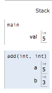
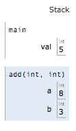
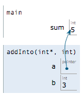
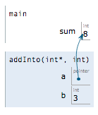

# Lab 07: Pointers

Welcome to CSC 211 Lab 07. Your goal for this lab is to gain a solid understanding of pointers: what they hold, how to dereference them, how they move through arrays, and how to trace code that uses them. **Be sure to read and follow all instructions unless otherwise specified.** Create a `lab-07.txt` document to record all of your lab answers in and implement all of your `.cpp` programs in your IDE.

1. C-style Pointers<br>
2. Pointers and Arrays<br>
3. Multidimensional Arrays<br>
4. Pointers to Pointers<br>
5. Submission<br>

> **Tracing tip:** For every "what does this output?" question, draw a box for each variable, write down its value, and draw an arrow for each pointer. Update the drawing line by line. Do not just run the code. Predict first, then verify in your IDE.

# Part 1. C-style Pointers
As we learned in class, a pointer (\*) is a variable that holds a memory address. By itself, a pointer cannot help us perform most of the tasks we've grown accustomed to doing, such as storing data. Instead, pointers allow us to pass data around our program in a different manner than we have been doing thus far, and to let a function change a variable that lives in another function. What fun!

The focus of today's lab is the simplest of pointer usage: passing a variable's memory address to a function and reading or writing through it.

If I were to ask you to write a void function that accepts two integers, *a* and *b*, then adds the value of *b* into *a*, you may do the following:

```c++
void add(int a, int b);

int main(){
  int val = 5;
  add(val, 3);
  std::cout << val << std::endl;
}

void add(int a, int b){
  a += b;
}
```
But the issue with this function is that since the add function has two integers as its parameters, every time this function is called it has two new memory locations for *a* and *b*, that hold copied values of whatever was given to them. Visually, it looks something like this.




Then after the addition occurs, we end up with this:



Since these variables are both local to the add() function, they disappear when the function exits and our 8 value is lost. This is exactly the issue that a pointer would fix. Instead of a being a new variable with its own memory address, we want it to point to an existing memory address.

```c++
void addInto(int* a, int b);

int main()
{
	int sum = 5;

	addInto(&sum, 3);
	std::cout << sum << std::endl;
}

void addInto(int* a, int b) {
	(*a) += b;
}
```

There are a few changes to the above code. First, our function accepts an integer pointer *a*, and an integer *b*, as opposed to the two integers it previously had. Second, instead of passing *sum* directly into the function call, we use the '&' to specify we want to pass the **memory address** of *sum*. Third, in our function we specify that we first want to **de-reference** *a* **prior** to performing the addition. Visually, our initial setup is this:



And the result after the addition is this:



:white_check_mark: 1. Create a void function called *square* that accepts an integer pointer and stores the square of that number into the passed address. Print this number in main.

:white_check_mark: 2. Write a void function *countEvens* that accepts an array, its size, and an integer pointer. The pointer should be used to count the # of even numbers in the array. Be sure to de-reference properly!

:white_check_mark: 3. What does the following code output? (You can assume it compiles).

```c++
#include <iostream>

int main() {
	int nums[] = {5, 10, 15, 20};
	int *x = &nums[2];
	int *y = x+1;
	std::cout << *x + *y;
}
```

:white_check_mark: 4. What does the following code output? (You can assume it compiles).

```c++
#include <iostream>

void foo(int x, int *someP) {
    *someP = x + 1;
    x = 80;
}

int main() {
    int a = 30;
    int b = 60;
    int *p = &a;
    int *z = &b;

    *p = 12;
    b = a;
    *p = 21;

    std::cout << "1: a=" << a << ", b=" << b << std::endl;
    foo(a, z);
    std::cout << "2: a=" << a << ", b=" << b << std::endl;

    *p = 1;
    p = z;
    *p = 3;

    std::cout << "3: a=" << a << ", b=" << b << std::endl;

    return 0;
}
```

:white_check_mark: 5. What does the following code output? Draw the memory diagram (boxes and arrows) after the line `p = q;` as part of your answer.

```c++
#include <iostream>

int main() {
    int a = 4;
    int b = 9;
    int *p = &a;
    int *q = &b;

    int t = *p;
    *p = *q;
    *q = t;

    p = q;
    *p += 10;

    std::cout << a << " " << b << " " << *p << " " << *q << std::endl;
    return 0;
}
```

:white_check_mark: 6. Write a void function *swap* that accepts two integer pointers and swaps the values they point to. Test it in main with two variables and print them before and after the call.

:white_check_mark: 7. What does the following code output? Explain in one or two sentences why `n` does or does not change, and how this differs from the `addInto` function above.

```c++
#include <iostream>

void change(int *p, int v) {
    p = &v;
    *p = 99;
}

int main() {
    int n = 1;
    change(&n, 50);
    std::cout << n << std::endl;
    return 0;
}
```

:white_check_mark: 8. The function below compiles, but it is a serious bug. What is wrong with it, and why might `main` print the wrong value (or crash)? *Hint: think about what happens to `v` when `getValue` returns.*

```c++
#include <iostream>

int* getValue() {
    int v = 42;
    return &v;
}

int main() {
    int *p = getValue();
    std::cout << *p << std::endl;
    return 0;
}
```

# Part 2. Pointers and Arrays

An array name is (nearly) the address of its first element, so a pointer can walk through an array. If `p` points to `v[0]`, then `p + 1` points to `v[1]`, `p + 2` points to `v[2]`, and so on. The compiler automatically scales the addition by the size of the type, so `p + 1` moves forward one *element*, not one byte. These expressions are all equivalent:

| Array notation | Pointer notation |
|:---:|:---:|
| `v[0]` | `*p` or `*v` |
| `v[i]` | `*(p + i)` or `p[i]` |
| `&v[i]` | `p + i` |

Subtracting two pointers into the same array gives the number of elements between them, e.g. `(p + 3) - p` is `3`.

:white_check_mark: 9. What does the following code output? Track `p` and the contents of `v` as the code runs.

```c++
#include <iostream>

int main() {
    int v[] = {2, 4, 6, 8, 10};
    int *p = v;

    std::cout << *p << " " << *(p + 3) << " " << p[1] << std::endl;

    p += 2;
    std::cout << *p << " " << *(p - 1) << " " << p[2] << std::endl;

    *p = *(p + 1) + v[0];
    p++;
    *p = 0;

    for (int i = 0; i < 5; i++) {
        std::cout << v[i] << " ";
    }
    std::cout << std::endl;

    std::cout << p - v << std::endl;
    return 0;
}
```

:white_check_mark: 10. What does the following code output?

```c++
#include <iostream>

int main() {
    int nums[] = {1, 2, 3, 4, 5, 6};
    int *start = nums;
    int *end = nums + 6;
    int total = 0;

    while (start < end) {
        total += *start;
        start += 2;
    }

    std::cout << total << std::endl;
    return 0;
}
```

:white_check_mark: 11. What does the following code output? Show the contents of `data` and the value of `result` after the call to `mystery`.

```c++
#include <iostream>

void mystery(int *arr, int n, int *out) {
    *out = 0;
    for (int i = 0; i < n; i++) {
        if (arr[i] % 2 == 0) {
            *out += arr[i];
        } else {
            arr[i] = -arr[i];
        }
    }
}

int main() {
    int data[] = {3, 4, 7, 10, 5};
    int result = 0;

    mystery(data, 5, &result);

    for (int i = 0; i < 5; i++) {
        std::cout << data[i] << " ";
    }
    std::cout << std::endl << result << std::endl;
    return 0;
}
```

:white_check_mark: 12. Write a void function *reverse* that accepts an int array and its size and reverses the array **in place** using two pointers: one starting at the first element and one starting at the last. Move them toward each other, swapping as you go, until they meet. Do not use `[]` inside the function. Print the array before and after in main.

:white_check_mark: 13. Write a void function *minMax* that accepts an int array, its size, and two integer pointers *min* and *max*. Use the pointers to return the smallest and largest values in the array to the caller. Print both values in main.

# Part 3. Multi-dimensional Arrays

Multi-dimensional arrays allow us to *gasp* store multiple dimensions worth of data!

The normal rules of arrays apply: you cannot determine the size of array outside the scope it is declared in, and you must specify the size of the dimensions. Well, except for the first one.

Lets take a look at the following code. In it, we have two functions: fillArray() and printArray(). Note that I am using a *const int* to determine the size of my array. This makes changing the size of my array dimensions easier. The fillArray() function simply creates 5 rows of {0, 1, 2, 3, 4}, while the printArray() function does what it says its does.

```c++
const int arrSize = 5;

void fillArray(int arr[][arrSize]);
void printArray(int arr[][arrSize]);

int main()
{
	int myArr[arrSize][arrSize];
	
	printArray(myArr);
	fillArray(myArr);
	printArray(myArr);
}

void fillArray(int arr[][arrSize]) {
	for (int i = 0; i < arrSize; i++) {
		for (int j = 0; j < arrSize; j++) {
			arr[i][j] = j;
		}
	}
}

void printArray(int arr[][arrSize]) {
	for (int i = 0; i < arrSize; i++) {
		for (int j = 0; j < arrSize; j++) {
			std::cout << arr[i][j] << " ";
		}
		std::cout << std::endl;
	}
	std::cout << std::endl;
}
```

The printArray() call prior to the fillArray() call prints out a 5x5 array of random values. Why is that?
When you declare an array without initializing it, you end up with an array filled with garbage values. Essentially, whatever was in that location in memory ends up in your array.

Wait a minute. the fillArray() function accepts an array (not a pointer to an array!), and is of type *void*. How are the values leaving the fillArray() function and displaying correctly in printArray()!?

As covered in lecture, the short answer; arrays are themselves references. This holds true for multi-dimensional arrays as well, regardless of the number of dimensions!

:white_check_mark: 14. Re-write the fillArray() function in the example above to store a multiplication table (without the headers) into *arr*. e.g. for *arrSize = 3* the array should be filled as:<br>
1 2 3<br>
2 4 6<br>
3 6 9<br>

:white_check_mark: 15. Write a program that will store 3 exam grades for 4 students as a multidimensional array, and a function to calculate the average for each student, and another function to calculate the average for each exam.

A 2D array is stored in memory as one continuous block, row after row. That means a single pointer can walk through every element of it. For `int grid[3][3]`, the element `grid[r][c]` lives at offset `r * 3 + c` from `&grid[0][0]`.

:white_check_mark: 16. What does the following code output? *Hint: lay the nine values out in a single line in memory, then move `p` along it.*

```c++
#include <iostream>

int main() {
    int grid[3][3] = {{1, 2, 3},
                      {4, 5, 6},
                      {7, 8, 9}};

    int *p = &grid[1][0];

    std::cout << *p << std::endl;
    std::cout << *(p + 2) << std::endl;
    std::cout << *(p + 4) << std::endl;
    std::cout << p[-1] << std::endl;
    std::cout << *(grid[0] + 7) << std::endl;
    std::cout << *(*(grid + 1) + 2) << std::endl;
    return 0;
}
```

:white_check_mark: 17. Write a function *sumDiagonal* that accepts a square 2D int array (using the `arrSize` constant from above) and returns the sum of the main diagonal (`arr[0][0]`, `arr[1][1]`, ...). Then write a void function *transpose* that swaps `arr[i][j]` with `arr[j][i]` in place. Test both on a 4x4 array that you fill with the values 1 through 16, and print the array before and after transposing.

# Part 4. Pointers to Pointers

A pointer is a variable too, so it has its own address, and we can store that address in another pointer. An `int**` is a "pointer to a pointer to an int". Each `*` you apply peels off one level of indirection: given `int **pp`, `pp` is the address of a pointer, `*pp` is that pointer, and `**pp` is the int it points to.

:white_check_mark: 18. What does the following code output? Draw the memory diagram after the line `*pp = &y;`.

```c++
#include <iostream>

int main() {
    int x = 5;
    int y = 8;
    int *p = &x;
    int **pp = &p;

    **pp = 6;
    *pp = &y;
    **pp += 2;
    *p = *p * 2;

    std::cout << x << " " << y << " " << *p << std::endl;
    return 0;
}
```

:white_check_mark: 19. Write a program that accepts a number of data points *n* (assume no more than 100), stores them into a fixed-size array, and uses a pointer *max* that will point to the largest value. Print the largest value by dereferencing *max*, and also print its index by subtracting the pointer to the start of the array from *max*.

:white_check_mark: 20. Create a void function called *findStats* that will calculate the mean, median, and mode of an array of ints of size *n*. Since a function cannot return three values directly, accept three **pointer parameters** (`double* mean`, `double* median`, `int* mode`) and store the results through them. Print all three in main. *Hint: sort a copy of the array first so that the median and mode are easier to find.*

# Part 5. Submission

Each group will submit a single **.zip file** named `lab-07.zip` containing all your answers to the lab questions in your `lab-07.txt` and all of your `.cpp` source code files on [Gradescope](http://gradescope.com) **before the end of your lab section**. **All submissions should be made by a group/team.** *Individual submissions will not be accepted.* Instructions to download your `lab-07.txt` file can be found in the IDE introduction page that you read in lab-01. For your convenience, that page is relinked [here](https://cs50.readthedocs.io/ide/online/).
